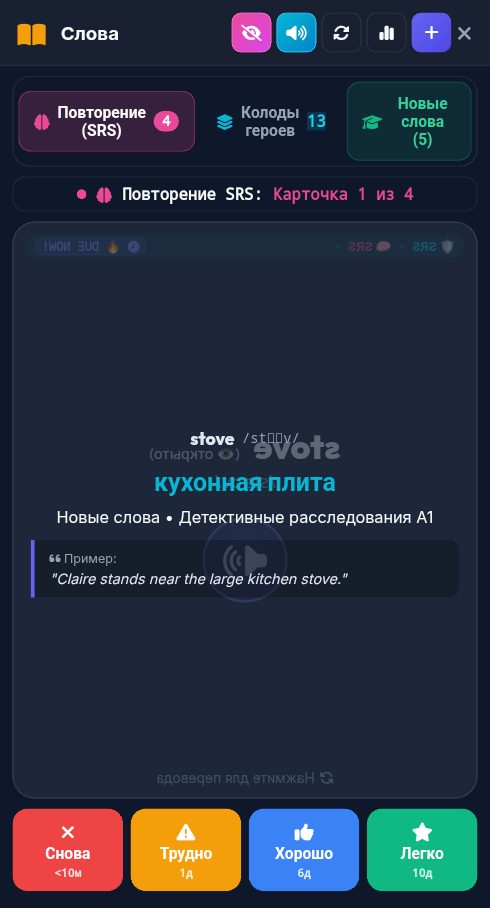

# 🐞 Отчёт о проблеме: report_2026-10-07_21-49-22____Vocab___Flashcards

- **📅 Дата и время:** 07.10.2026, 22:49:22
- **🕹️ Режим / Экран:** 📚 Vocab & Flashcards
- **👤 Активный герой:** Valerius Lvl 100
- **🏷️ Категория:** 🔊 Озвучка / Звук
- **📐 Разрешение экрана:** 392x512

---

## 📝 Описание пользователя
> Озвучка с помехами в конце

---

## 📸 Скриншот экрана


---

## 🛠️ Дополнительная информация
- **URL:** `https://englishpulserpg.share.zrok.io/`
- **Контекст:** Сценарий: Tech Job Interview
- **User Agent:** `Mozilla/5.0 (Linux; Android 12; Redmi Note 10S Build/SP1A.210812.016) AppleWebKit/537.36 (KHTML, like Gecko) Chrome/135.0.7049.79 Mobile Safari/537.36 XiaoMi/MiuiBrowser/14.62.1-gn`

### 📋 Последние логи / ошибки браузера:
```json
[
  {
    "type": "error",
    "time": "22:48:12",
    "msg": "[Bug Report Capture Error] {\"message\":\"Failed to execute 'addColorStop' on 'CanvasGradient': The provided double value is non-finite.\"}"
  },
  {
    "type": "error",
    "time": "22:48:13",
    "msg": "[Submit Report Error] {}"
  }
]
```

---

## ✅ Статус исправления
- **Статус:** Решено
- **Причина:** Ответ Gemini TTS уже является полноценным WAV-файлом с C2PA-метаданными Google (SynthID watermark) в конце файла. При оборачивании в функцию `pcmToWav` поверх накладывался второй RIFF-заголовок, из-за чего бинарные байты водяного знака C2PA декодировались плеером браузера как 16-битный PCM-звук максимальной громкости (помехи/треск в самом конце слова `stove`).
- **Решение:** В [server.js](file:///c:/dev/english_app/server.js) обновлена функция `pcmToWav`: теперь она проверяет наличие RIFF-контейнера и извлекает только валидные чанки `fmt ` и `data`, начисто отсекая любые посторонние метаданные. Все 18 затронутых WAV-файлов слов (`stove`, `mud`, `bark` и др.) и кэш очищены и пересобраны.
