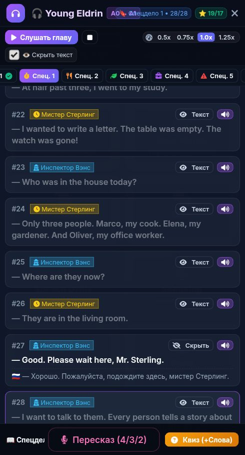

# 🐞 Отчёт о проблеме: report_2026-10-23_23-55-18____Аудиокнига

- **📅 Дата и время:** 24.10.2026, 00:55:18
- **🕹️ Режим / Экран:** 🎧 Аудиокнига
- **👤 Активный герой:** Valerius Lvl 100
- **🏷️ Категория:** 🐛 Баг / Ошибка
- **📐 Разрешение экрана:** 392x727

---

## 📝 Описание пользователя
> Сокращения типа Mr. озвучиваются с заиканием, лучше полностью прописывать для аудио книги

---

## 📸 Скриншот экрана

---

## 🛠️ Дополнительная информация
- **URL:** `https://english.net-forge.ru/`
- **Контекст:** Сценарий: Tech Job Interview
- **User Agent:** `Mozilla/5.0 (Linux; Android 12; Redmi Note 10S Build/SP1A.210812.016) AppleWebKit/537.36 (KHTML, like Gecko) Chrome/135.0.7049.79 Mobile Safari/537.36 XiaoMi/MiuiBrowser/14.65.0-gn`

### 📋 Последние логи / ошибки браузера:
_Логов ошибок консоли нет_

---

## ✅ Статус исправления
- **Статус:** Решено
- **Причина:** Точка в сокращениях `Mr.` и `Dr.` воспринималась генератором SSML как конец предложения со вставкой паузы `<break time="300ms"/>` (например, `Mr. <break time="300ms"/> Sterling`). Движок Google Cloud Neural2 озвучивал это как заикание перед фамилией персонажа.
- **Решение:** Все сокращения (`Mr.` -> `Mister`, `Dr.` -> `Doctor`) полностью прописаны во всех главах и спецделах аудиокниги в [eldrin_story.js](file:///c:/dev/english_app/eldrin_story.js), [new_words_study.js](file:///c:/dev/english_app/new_words_study.js), [scripts/generate_audiobook_gcloud.js](file:///c:/dev/english_app/scripts/generate_audiobook_gcloud.js) и [ai_service.js](file:///c:/dev/english_app/ai_service.js). Все 24 затронутых предложения переозвучены на Google Cloud Neural2 без пауз, а в [app.js](file:///c:/dev/english_app/app.js) инкрементирован cache-buster (`?v=3`).
