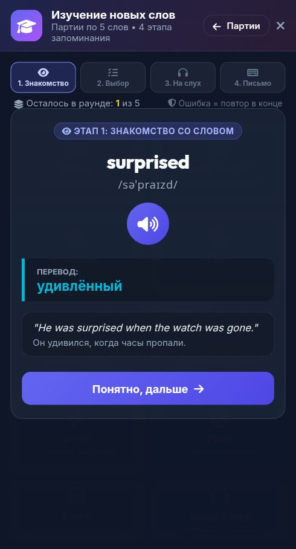

# 🐞 Отчёт о проблеме: report_2026-10-25_23-26-56____Главный_экран__Hero_Showcas

- **📅 Дата и время:** 26.10.2026, 00:26:56
- **🕹️ Режим / Экран:** 🏰 Главный экран (Hero Showcase Hub)
- **👤 Активный герой:** Valerius Lvl 100
- **🏷️ Категория:** 🔊 Озвучка / Звук
- **📐 Разрешение экрана:** 392x727

---

## 📝 Описание пользователя
> Неверная озвучка слова

---

## 📸 Скриншот экрана

---

## 🛠️ Дополнительная информация
- **URL:** `https://english.net-forge.ru/`
- **Контекст:** Сценарий: Tech Job Interview
- **User Agent:** `Mozilla/5.0 (Linux; Android 12; Redmi Note 10S Build/SP1A.210812.016) AppleWebKit/537.36 (KHTML, like Gecko) Chrome/135.0.7049.79 Mobile Safari/537.36 XiaoMi/MiuiBrowser/14.65.0-gn`

### 📋 Последние логи / ошибки браузера:
_Логов ошибок консоли нет_

---

## ✅ Статус исправления
- **Статус:** Решено
- **Причина:** Для слова `surprised` (и ещё 15 недавно добавленных слов детективного модуля) отсутствовал офлайн-аудиофайл в `audio/words/`. При динамическом обращении к `/api/ai/gemini-tts` модель Gemini (являясь диалоговой LLM) восприняла переданное слово как фразу собеседника и вместо чтения вслух сгенерировала аудио-ответ: *"Oh, wow! I didn't expect that to show up today!"*, который затем закэшировался на диске.
- **Решение:**
  1. Сгенерированы чистые студийные офлайн-аудиофайлы на движке **Google Cloud Text-to-Speech (Neural2)** для всех 16 недостающих слов: `surprised`, `captain`, `asleep`, `nervous`, `sorry`, `sad`, `email`, `tail`, `toy`, `cupboard`, `mistake`, `clever`, `sign`, `pound`, `opposite`, `turn`.
  2. В [server.js](file:///c:/dev/english_app/server.js) в эндпоинт `/api/ai/gemini-tts` интегрирован прямой вызов Google Cloud TTS Neural2 как приоритетного движка озвучки, исключающего любые галлюцинации и разговорные реплики нейросети.
  3. Удалены ошибочные разговорные кэши из `audio/cache/`. Произношение `surprised.wav` проверено через Whisper — звучит чётко: *"Surprised!"*.

