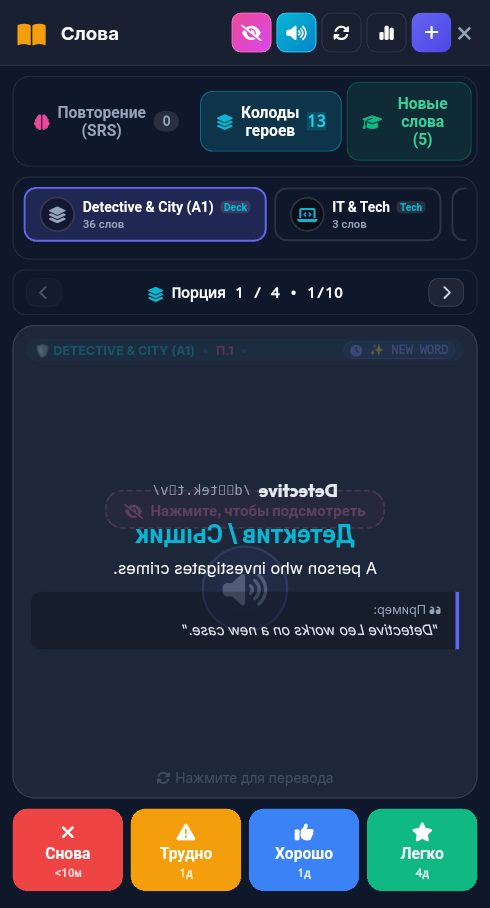

# 🐞 Отчёт о проблеме: report_2026-10-26_22-49-49____Vocab___Flashcards

- **📅 Дата и время:** 26.10.2026, 23:49:49
- **🕹️ Режим / Экран:** 📚 Vocab & Flashcards
- **👤 Активный герой:** Valerius Lvl 100
- **🏷️ Категория:** 🐛 Баг / Ошибка
- **📐 Разрешение экрана:** 392x727

---

## 📝 Описание пользователя
> Почему то в этом наборе всего 36 слов, хотя изучено больше (из раздела с новыми словами)

---

## 📸 Скриншот экрана

---

## 🛠️ Дополнительная информация
- **URL:** `https://english.net-forge.ru/`
- **Контекст:** Сценарий: Tech Job Interview
- **User Agent:** `Mozilla/5.0 (Linux; Android 12; Redmi Note 10S Build/SP1A.210812.016) AppleWebKit/537.36 (KHTML, like Gecko) Chrome/135.0.7049.79 Mobile Safari/537.36 XiaoMi/MiuiBrowser/14.65.0-gn`

### 📋 Последние логи / ошибки браузера:
_Логов ошибок консоли нет_

---

## ✅ Статус исправления
- **Статус:** Решено
- **Причина:** Исходный массив `GENERAL_DECKS["Detective & City (A1)"]` в [flashcards.js](file:///c:/dev/english_app/flashcards.js) содержал только первые 36 слов. При успешном прохождении партий в разделе «Изучение новых слов» движок [new_words_study.js](file:///c:/dev/english_app/new_words_study.js) ошибочно отправлял изученные слова в отдельную колоду с другим названием (`🔍 Новые слова (Детектив)`), вместо пополнения основной детективной колоды `Detective & City (A1)`. В результате в `Detective & City (A1)` оставалось 36 слов, хотя пользователем было изучено 85 слов.
- **Решение:**
  1. Колода `GENERAL_DECKS["Detective & City (A1)"]` расширена всеми словами базы `NEW_WORDS_DATABASE` (до 101 слова с примерами, фонетикой и переводом).
  2. В [new_words_study.js](file:///c:/dev/english_app/new_words_study.js) синхронизация и передача в интервальное повторение перенаправлена прямо в колоду `Detective & City (A1)`.
  3. В [flashcards.js](file:///c:/dev/english_app/flashcards.js) добавлено автоматическое слияние карточек из старой отдельной колоды `🔍 Новые слова (Детектив)` в `Detective & City (A1)` с сохранением прогресса повторений (интервалы, даты, счетчики).
  4. Обновлены синхронизированные данные игрока: теперь в `Detective & City (A1)` отображаются все изученные 85 слов (и полный пул новых слов), дублирующая колода удалена.

